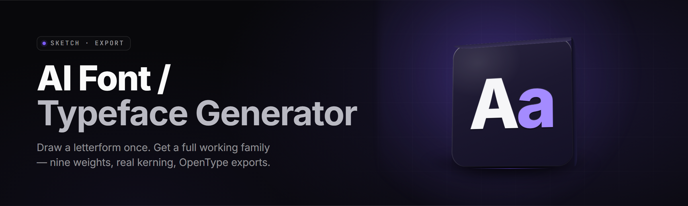

  
  
  

  

  
  

---

**A local, offline AI typeface generator for Windows — diffusion-guided glyph synthesis, variable-font export, and a full outline editor. No cloud, no subscription, no font foundry.**

---

## 📦 System Requirements

Everything runs on-device. The generator ships as a single portable `.exe` with bundled model weights, so no Python, no CUDA install, and no package manager.

| Component | Minimum | Recommended |
|---|---|---|
| OS | Windows 10 21H2 x64 | Windows 11 23H2 x64 |
| CPU | 4-core / 8-thread (AVX2) | 8-core / 16-thread (AVX-512) |
| RAM | 8 GB | 16 GB |
| GPU | DirectX 12 / Vulkan 1.2, 4 GB VRAM | 8 GB+ VRAM (RTX 3060 / RX 6700 class) |
| Storage | 3.5 GB free (SSD) | 6 GB free (NVMe) |
| Display | 1280×720 | 1920×1080 or higher |
| .NET | Desktop Runtime 8.0 (bundled) | Desktop Runtime 8.0 |
| Admin rights | Not required | Recommended for font-folder install |

> First launch unpacks ~2.1 GB of glyph-diffusion weights into `%LOCALAPPDATA%\AIFontGen\models`. Keep that folder intact — deleting it forces a re-extract on next run.

---

## ❓ FAQ

| Question | Answer |
|---|---|
| Does it need an internet connection? | No. All inference is local; the only network call is an optional update check you can disable in settings. |
| What font formats can it export? | Static TTF/OTF, variable TTF (weight/width/slant axes), WOFF2 for web, and SVG outlines for design tools. |
| Can I train my own style? | Yes — drop 20–200 reference glyphs into a style set and run the fine-tune pass. Takes 10–40 min on a mid-range GPU. |
| Does it handle CJK? | Full Latin, Cyrillic, Greek, and Kana out of the box. CJK ideographs are supported via an optional 700 MB weight pack. |
| Will exported fonts install system-wide? | Yes — install to `%WINDIR%\Fonts` or load per-app. Admin rights needed for system-wide install. |
| Is it a subscription? | No. One download, offline forever. Model packs are optional and free. |
| Why is my VRAM usage high? | The diffusion sampler allocates a full glyph tile batch. Lower "Batch Glyphs" in settings to reduce VRAM at a small speed cost. |
| Can I import an existing font? | Yes — import TTF/OTF and use it as a base for interpolation, morphing, or style transfer. |

---

## 🗺️ Table of Contents

- [📦 System Requirements](#-system-requirements)
- [❓ FAQ](#-faq)
- [🗂️ Overview](#️-overview)
- [🔤 What is an AI Typeface Generator?](#-what-is-an-ai-typeface-generator)
- [⚙️ Key Features](#️-key-features)
- [🪤 The Problem](#-the-problem)
- [🧩 The Solution](#-the-solution)
- [🚀 Quick Start](#-quick-start)
- [📊 Comparison](#-comparison)
- [✒️ Glyph Generation Modules](#️-glyph-generation-modules)
- [🔡 Typography Modules](#-typography-modules)
- [🎛️ Editing Modules](#️-editing-modules)
- [📐 Export & Metrics Modules](#-export--metrics-modules)
- [🧠 Model & Style Modules](#-model--style-modules)
- [🖥️ UI & Workflow Modules](#️-ui--workflow-modules)
- [⌨️ Hotkeys](#️-hotkeys)
- [🐛 Known Issues](#-known-issues)
- [📥 Installation](#-installation)
- [⚖️ Usage Guidelines](#️-usage-guidelines)
- [📥 Download](#-download)

---

## 🗂️ Overview

**AI Font / Typeface Generator 2026** is a Windows desktop tool for turning a handful of reference glyphs — or nothing but a style prompt — into a complete, production-ready typeface. It runs diffusion and interpolation models locally on your GPU, hands you a real outline editor, and exports variable fonts that drop straight into Figma, Illustrator, Unity, or a web project.

| Category | Details |
|---|---|
| Product type | Offline AI typeface generator + outline editor |
| Platform | Windows 10/11 x64 (portable `.exe`) |
| Core engine | Glyph-diffusion sampler + vector interpolation + metrics solver |
| Input | Style prompt, reference glyph images, existing fonts, sketch scans |
| Output | TTF, OTF, variable TTF, WOFF2, SVG outlines, specimen PDF |
| Weight packs | Latin/Cyrillic/Greek/Kana bundled; CJK optional |
| License | MIT |
| Year | 2026 |

It is not a web app and it is not a plugin. You download it, extract it, run the `.exe`, and you have a font generator on your machine.

---

## 🔤 What is an AI Typeface Generator?

| Term | Explanation |
|---|---|
| Glyph | A single drawn character (the letter "A", the digit "3", a symbol). |
| Typeface / Font | A family of glyphs sharing a design; a font is the file that carries them. |
| Outline | The Bézier curves that define a glyph's shape, as opposed to a bitmap. |
| Variable Font | A single file holding multiple design axes (weight, width, slant) that interpolate smoothly. |
| Metrics | Spacing, sidebearings, kerning, and vertical alignment that make text readable. |
| Style Transfer | Applying the visual DNA of a reference set to new glyphs. |
| Diffusion Sampler | The AI step that turns noise + a prompt into a plausible vector shape. |

**Why builders use it:**

- Generate a full family from three reference letters instead of drawing hundreds.
- Prototype a brand typeface in an afternoon, not a semester.
- Keep every glyph editable — the AI proposes, you refine the outlines.
- Export real, standards-compliant fonts with metrics already solved.
- No cloud round-trips, no per-font pricing, no watermarks.

---

## ⚙️ Key Features

| Feature | Description | Benefit |
|---|---|---|
| Glyph Diffusion Engine | Samples plausible outlines from a style prompt + noise seed. | Full alphabet from a vibe. |
| Reference Style Transfer | Learns design DNA from 20–200 uploaded glyphs. | Match an existing brand font. |
| Variable Axis Builder | Interpolates weight, width, slant, and optical size. | One file, infinite cuts. |
| Live Outline Editor | Bézier node editing with snapping and auto-smoothing. | Ship precision, not just AI output. |
| Metrics Auto-Solver | Computes sidebearings and kerning from spacing rules. | Text that actually reads well. |
| Kerning Pair Optimizer | Detects and fixes awkward letter pairs automatically. | No manual kerning grind. |
| Font Import & Morph | Import TTF/OTF as a base and morph toward a new style. | Evolve existing families. |
| Batch Glyph Mode | Generate a whole Unicode block in one pass. | Fast CJK/cyrillic expansion. |
| Specimen Generator | Renders a printable specimen PDF of the finished font. | Present to clients instantly. |
| Weight Pack System | Optional packs for CJK, Arabic, Devanagari. | Global script coverage. |
| Offline Inference | Everything runs locally on GPU or CPU. | Privacy, speed, no bills. |
| Project Save/Load | Full project state with glyphs, axes, and settings. | Pick up where you stopped. |

---

## 🪤 The Problem

- Drawing a complete typeface by hand takes months — even a single weight is weeks of node-pushing.
- AI font tools online are locked behind subscriptions and render watermarked previews.
- Web generators export bitmaps or low-quality SVG, not real installable fonts.
- Most tools ignore metrics — you get pretty glyphs but terrible spacing and kerning.
- Style transfer tools can't be steered; you feed them a font and accept whatever comes out.
- No local workflow means uploading your unreleased brand font to someone else's server.
- Variable-font authoring is buried in pro apps with a brutal learning curve.

---

## 🧩 The Solution

| Problem | Solution |
|---|---|
| Months of manual drawing | Diffusion engine drafts a full alphabet in minutes. |
| Subscription lock-in | Fully offline, MIT-licensed, one-time download. |
| Bitmap / fake-vector export | True Bézier outlines exported as TTF/OTF/WOFF2. |
| Bad spacing | Metrics auto-solver plus kerning pair optimizer. |
| Unsteerable style transfer | Adjustable style-strength, seed, and axis controls. |
| Privacy risk | Local inference, zero uploads, no telemetry. |
| Variable-font learning curve | Guided axis builder with live preview. |

---

## 🚀 Quick Start

1. 🧾 **Visit the project page** and grab the latest release archive.
2. 📦 **Extract** the ZIP to any folder — no installer needed.
3. 🖱️ **Run** the `.exe`; first launch unpacks model weights.
4. ✍️ **Enter a style prompt** or load reference glyphs, then hit Generate.
5. 💾 **Refine in the editor** and export TTF/OTF/variable/WOFF2.

---

## 📊 Comparison

| Aspect | Typical Web Generator | Font Design App | This Tool |
|---|---|---|---|
| Cost | Subscription | $200+ one-time | Free (MIT) |
| Offline | No | Yes | Yes |
| AI glyph synthesis | Limited | None | Full diffusion |
| Variable font export | Rare | Yes | Yes |
| Metrics solver | No | Manual | Automatic |
| Style transfer | Basic | No | Steerable |
| Output format | PNG/SVG | TTF/OTF | TTF/OTF/VF/WOFF2/SVG |
| Privacy | Uploads files | Local | Local |

---

## ✒️ Glyph Generation Modules

**Core Synthesis**
- **Diffusion Sampler** — turns noise + prompt into Bézier outlines.
- **Seed Control** — lock a seed to reproduce a glyph exactly.
- **Style Strength** — dial how strongly references steer the output.
- **Batch Block Fill** — generate a whole Unicode range in one run.

**Reference Handling**
- **Glyph Reference Loader** — ingest PNG/SVG/TTF references.
- **Style DNA Extractor** — distills references into a compact style vector.
- **Consistency Pass** — re-samples glyphs that drift from the family.

---

## 🔡 Typography Modules

**Metrics**
- **Sidebearing Solver** — computes left/right spacing from stroke logic.
- **Kerning Pair Optimizer** — fixes awkward pairs across the charset.
- **Vertical Metrics** — sets ascender, descender, and line gap.

**Axes**
- **Weight Axis Builder** — interpolates thin → black.
- **Width Axis Builder** — condensed → extended.
- **Slant Axis Builder** — roman → italic.
- **Optical Size Axis** — display → text cuts.

---

## 🎛️ Editing Modules

- **Bézier Node Editor** — full node/curve control with snapping.
- **Auto-Smoothing** — clean up jagged AI outlines in one click.
- **Glyph Onion Skinning** — overlay neighbors for consistency.
- **Copy/Paste Glyph Parts** — reuse stems, bowls, serifs.
- **Undo History** — deep, per-glyph undo stack.
- **Spacing Preview** — see a glyph in a real word context.

---

## 📐 Export & Metrics Modules

- **TTF Exporter** — standard static TrueType.
- **OTF Exporter** — CFF-flavored OpenType.
- **Variable Font Exporter** — multi-axis TTF.
- **WOFF2 Exporter** — optimized for web.
- **SVG Outline Exporter** — individual glyph vectors.
- **Specimen PDF Generator** — printable presentation sheet.
- **Metadata Editor** — name, family, copyright, license fields.

---

## 🧠 Model & Style Modules

- **Bundled Latin Pack** — Latin, Cyrillic, Greek, Kana.
- **CJK Pack (optional)** — 700 MB ideograph weights.
- **Fine-Tune Pass** — train a style from your reference set.
- **Model Manager** — add, remove, and switch weight packs.
- **CPU Fallback** — run without a GPU, slower but complete.
- **Vulkan Backend** — GPU acceleration across vendors.

---

## 🖥️ UI & Workflow Modules

- **Project Save/Load** — full state persistence.
- **Dark/Light Theme** — editor appearance.
- **Live Preview Panel** — real-time rendering of the family.
- **Settings & Presets** — save generation presets.
- **Update Checker** — optional, disableable.
- **Portable Mode** — run from USB with no install.

---

## ⌨️ Hotkeys

| Action | Shortcut |
|---|---|
| Generate current glyph | `Ctrl+G` |
| Generate full block | `Ctrl+Shift+G` |
| Toggle node editor | `Tab` |
| New project | `Ctrl+N` |
| Save project | `Ctrl+S` |
| Export font | `Ctrl+E` |
| Toggle preview | `Ctrl+P` |

---

## 🐛 Known Issues

| Issue | Solution |
|---|---|
| First launch slow (weight extract) | Expected — one-time ~2.1 GB unpack. |
| High VRAM on large batches | Lower "Batch Glyphs" in settings. |
| CJK glyphs missing | Install the optional CJK weight pack. |
| Font not showing after install | Reboot or refresh font cache; admin needed for system install. |
| CPU mode very slow | Use GPU backend or reduce batch size. |
| Kerning looks off for rare pairs | Run Kerning Pair Optimizer manually. |

---

## 📥 Installation

1. **Download** — grab the latest Windows x64 archive from the project page.
2. **Extract** — unzip to any folder; no installer runs, nothing writes to the registry.
3. **Run** — launch the `.exe`; models unpack on first run and you're ready to generate.

---

## ⚖️ Usage Guidelines

| Allowed | Not allowed |
|---|---|
| Generating and selling fonts you create | Redistributing bundled model weights standalone |
| Using outputs in commercial projects | Claiming the tool created a font you didn't generate |
| Modifying and forking the source (MIT) | Removing license notices from the source |
| Training style packs from your own references | Training on copyrighted fonts you don't own |

---

## 📥 Download

  

---

Generate a family in an afternoon, keep every glyph editable, and ship a real variable font that installs like any other. The whole pipeline lives on your machine — no cloud, no subscription, no watermark. Extract, run the `.exe`, and start building type.

  

